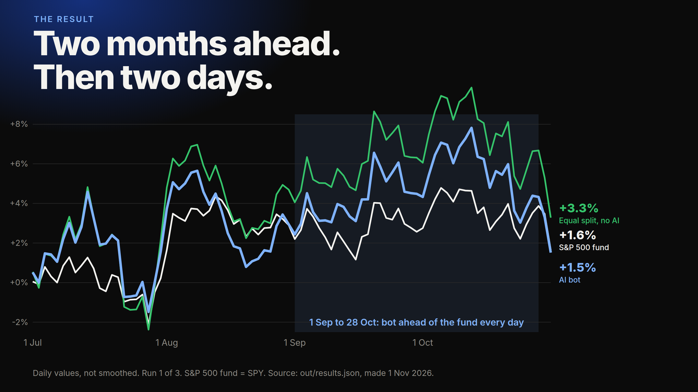

# Can an AI trade stocks? A small, honest test



I gave Claude a paper-money account with 10 large US stocks. Each trading day it saw past prices and picked its mix. It ended a little behind a plain index fund.

Education only, not financial advice.

## The result (1 Jul to 30 Oct 2026, 86 trading days)

- The AI bot ended **+1.51%**, after fees.
- An S&P 500 fund (SPY), bought once and held, ended **+1.64%**.
- An equal split of the same 10 stocks, never traded, ended **+3.28%**.
- Two reruns of the same bot ended **+2.15%** and **+2.16%**. The spread between runs is larger than the gap to SPY, so there is no clear edge.

## How it works

- **Model:** Claude Opus 5.5 (`claude-opus-5-5`). Its training data ends in **Jun 2026**.
- **Test days:** 1 Jul to 30 Oct 2026. Every test day is after the training cutoff, so the model cannot remember these prices.
- **Input:** prices only. Each day the model sees the last 60 daily closes and its current holdings. No news, no tools, no web.
- **Leak guard:** an `assert` in `core.build_prompt` stops the run if any price from today or later reaches the model. Tests in `tests/test_no_leak.py` check this too.
- **Fills:** the model decides before the open. Trades fill at that day's open price.
- **Fees:** 0.05% of each trade's value.
- **Small changes skipped:** a change under 0.5% of the account is not traded.
- **Rules:** no short selling and no borrowing. Cash takes what is left.

## Run it yourself

You need Python 3.13 or newer.

```bash
pip install -r requirements.txt
python fetch_data.py                 # downloads the daily prices from Yahoo Finance
```

**Free replay (no API key, no cost).** This reuses the model's saved replies in `logs/`:

```bash
python run_bot.py --run 1 --replay
```

It prints the same summary as the original run and writes to `out/replay/`. Yahoo adjusts old prices after new dividends, so a fresh download can differ a little from mine. The replay tells you if that happened.

**Full run with your own API key.** This calls the model once per trading day:

```bash
export ANTHROPIC_API_KEY=...          # your own key
python run_bot.py --run 4 --estimate # counts tokens first, no model call
python run_bot.py --run 4
```

One run cost about **$1.66**. That figure is computed from token counts and the list price ($4 per million input tokens, $20 per million output tokens). It is not read from a bill. Each run stops itself if its spend passes a cap (`--cap`, default $25).

**Tests and charts:**

```bash
python -m pytest tests
python make_results.py               # rebuilds out/results.json and the charts
```

## Limits

- **A replay, not live trading.** The test ran after the fact on past days.
- **Paper money.** No real orders. Real fills, slippage and fees differ.
- **Hindsight in the stock list.** I picked 10 large US stocks with today's knowledge.
- **One model.** Other models could do better or worse.
- **Three runs.** The API does not accept a fixed temperature, so reruns differ.
- **86 days.** One short window says nothing about the future.

## Files

- `config.py`: every fixed setting (model, dates, fees, spend cap)
- `core.py`: the prompt, the leak guard, the timing rule and the account
- `run_bot.py`: the live run, plus `--estimate` and `--replay`
- `fetch_data.py`: downloads the prices
- `make_results.py`: builds `out/results.json` and the charts
- `logs/run{1,2,3}.jsonl`: every prompt and reply, one line per day
- `out/`: results, daily value curves and run summaries
- `tests/`: leak, timing, fee and chart tests

## Price data

Prices come from Yahoo Finance through `yfinance`. The price CSVs are not in this repo. Run `fetch_data.py` to download them. `data/raw/download_meta.json` shows when the original download was made.

## Learn the method

Learn the method: https://learn.thuztra.com/yt/reference/can-ai-guess-tomorrows-market

## License

MIT. See [LICENSE](LICENSE).
